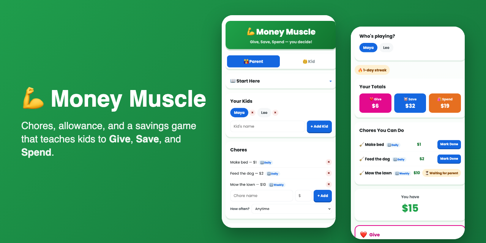
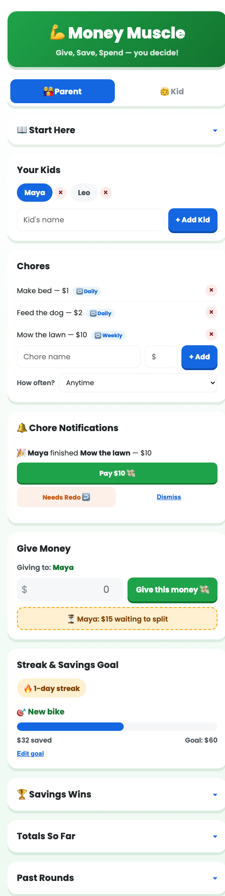
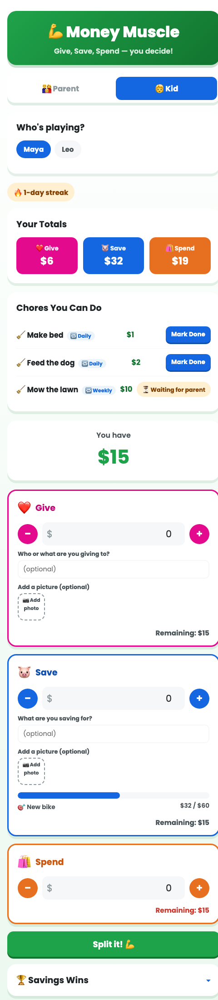

# Money Muscle

**A chores-and-allowance app that teaches kids to Give, Save, and Spend, plus an optional game that rewards real saving.**

**[Try the live demo →](https://asher40121.github.io/money-muscle/)** No sign-up needed; all data stays in your browser.



## Contents

1. [About the project](#about-the-project)
2. [Installation](#installation)
3. [Key features](#key-features)
4. [Usage](#usage)
5. [API reference](#api-reference)
6. [Project structure](#project-structure)

## About the project

**Purpose.** Most kids get money through chores or an allowance, but nothing turns that money into a habit. Money Muscle makes every payment a small decision: before a kid can use their money, they choose how much to **Give**, **Save**, and **Spend**.

**Goals.**
- Make saving visible and rewarding, with savings goals, streaks, and celebrations
- Keep parents in control of chores, payments, goals, and game time
- Reward saving without ever encouraging spending: the game can't move, approve, or request money

**Intended audience.**
- **Families** with kids roughly 6–14 who already pay for chores or give an allowance
- **Developers and reviewers** interested in a dependency-free web app with a cleanly separated, well-tested game layer

**Built with:** HTML, CSS, and JavaScript (no framework or build step), browser `localStorage`, native ES modules, [Phaser 3](https://phaser.io/) for the game world, and Node's built-in test runner.

## Installation

Money Muscle is a set of static files with **no dependencies to install**.

**System requirements**
- A modern browser (Chrome, Safari, Edge, or Firefox)
- [Git](https://git-scm.com/) to download the code
- [Python 3](https://www.python.org/) (or any static file server) to run it locally
- [Node.js](https://nodejs.org/) 18 or newer, only if you want to run the tests

**Steps**

1. Download the code:
   ```bash
   git clone https://github.com/Asher40121/money-muscle.git
   ```
2. Go into the project folder:
   ```bash
   cd money-muscle
   ```
3. Start a local web server:
   ```bash
   python3 -m http.server 8000
   ```
4. Open <http://localhost:8000> in your browser.

   Use a server rather than double-clicking `index.html`: browsers block the game's ES modules when a page is opened directly from disk.

5. *(Optional)* Run the automated tests:
   ```bash
   cd savings-quest
   npm test
   ```

## Key features

**For parents**
- **Multiple kids:** a separate profile, balance, and history for each child
- **Chore board:** set chores with a price and frequency; review a kid's "done" photo, then pay, ask for a redo, or dismiss
- **Give money and set goals:** send chore pay or allowance to a specific kid and set a savings goal
- **Progress at a glance:** totals, past rounds, saving streaks, and completed goals

**For kids**
- **Give / Save / Spend split:** decide where each dollar goes, with optional notes and photos
- **Savings goals:** a progress bar toward a goal, with a celebration when it's reached

**Savings Quest (optional game)**
- **A hero powered by saving:** XP comes from money a kid moves into Save, never from spending or tapping a buy button
- **Progression:** levels, unlockable gear and skills, and saving streaks
- **An open world:** regions to explore, puzzles, quests, and friendly (non-violent) boss encounters
- **Money lessons:** a character in each region teaches one idea, such as saving a little often or needs vs. wants
- **Real goals in the game:** the kid's real savings goal appears as a landmark that builds as they get closer
- **Parent controls:** on/off per child, daily play-time limits, quiet hours, XP speed, plus cheers and bonus XP

**Under the hood**
- **Zero dependencies:** no framework, bundler, or npm packages; Phaser loads from a CDN only when a kid opens the game world
- **Tested logic:** XP math, level curves, streaks, unlock rules, anti-farming protection, and parent settings are pure functions covered by 113 automated tests
- **Resilient storage:** if browser storage fails, the app degrades instead of crashing

## Usage

### 1. Parent: set up kids, chores, and a goal

Add each child in **Your Kids**, add chores with a price in **Chores**, and use **Give Money** to send an amount and set a savings goal. When a kid marks a chore done, it appears here for you to pay, send back, or dismiss.



### 2. Kid: split the money

Switch to the **🧒 Kid** tab and hand over the device. The kid sees how much they have and splits it between Give, Save, and Spend. Their goal progress updates as soon as they save.



### 3. Turn on Savings Quest

In the Parent view, check **Turn on Savings Quest**. On the Kid tab, your child builds a hero, and from then on every dollar they save earns XP toward new gear, skills, and regions.

### Example: a full round

1. A parent approves a $10 "Mow the lawn" chore.
2. On the Kid tab, the child splits it: **$6 Save**, **$3 Spend**, **$1 Give**.
3. The $6 moves their "New bike" goal bar forward, and their streak continues.
4. With Savings Quest on, the hero earns XP for the $6 saved, and may level up or unlock new gear.

## API reference

Money Muscle has no server or web API. Its one programming interface is the **`window.SavingsQuest`** bridge, which connects the main app to the Savings Quest game. It's defined in [`savings-quest/bootstrap.js`](savings-quest/bootstrap.js).

**Design rule:** data flows in one direction only. The main app tells the game what happened; the game never changes the main app's money data. Every call from the main app is wrapped in optional chaining and `try/catch`, so the app keeps working if the game fails to load.

### Events (main app → game)

| Method | Called when | Argument |
|---|---|---|
| `onSplitCompleted(context)` | A kid finishes a Give/Save/Spend split | `{ round, priorSaveTotal, goal }` |
| `onChoreApproved(completion)` | A parent pays for a completed chore | The stored chore-completion record |

Both events are **verified before any XP is written**: the game checks the passed-in record against the app's own stored data and ignores anything that doesn't match. A record typed into the browser console can't earn XP.

```js
// In index.html, after a split is saved:
window.SavingsQuest?.onSplitCompleted?.({ round, priorSaveTotal, goal });
```

### Read methods (active kid only)

| Method | Returns |
|---|---|
| `isEnabled()` | Whether Savings Quest is on for the family |
| `getHero()` | The active kid's hero: level, XP, and stats |
| `getLedger()` | The active kid's XP history |
| `getMilestones()` | The active kid's goal milestones |
| `levelForTotalXp(xp)` | The level for a given XP total |

These deliberately take no kid ID, so a page script can only read the currently selected child's data.

### Other methods

| Method | Purpose |
|---|---|
| `setEnabled(on)` | Turn Savings Quest on or off for the family |
| `renderKidPanel()` / `renderParentPanel()` | Redraw the game's panels after app data changes |
| `runBackfill()` | Award XP for savings recorded before the game was turned on |

For architecture, tuning, and rollout details, see [docs/savings-quest.md](docs/savings-quest.md).

## Project structure

```
money-muscle/
├── index.html              # The main app: Parent and Kid views, chores, goals
├── docs/
│   ├── savings-quest.md    # Game architecture, tuning, and rollout notes
│   └── screenshots/
└── savings-quest/          # The optional game layer (native ES modules)
    ├── bootstrap.js        # Entry point; defines window.SavingsQuest
    ├── engine.js           # XP, levels, and streaks (pure functions)
    ├── unlocks.js          # Gear and skill unlock rules
    ├── world.js            # Phaser open world
    ├── ui.js / ui.css      # Hero, dashboard, and parent panels
    ├── content/            # Items, skills, regions, quests, bosses, lessons (JSON)
    └── test/               # Automated tests (node --test)
```

---

Designed and built by **Phil Albritton**.
